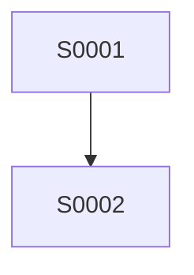

# Breakdown Specs

Transformar um prompt grande em **várias specs pequenas**, cada uma entregando **uma capacidade** que pode ser implementada, testada e commitada sozinha com `implement-me`.

Esta skill decide **como cortar**, **em que ordem** e **o que cada fatia cobre e não cobre**. Quem escreve cada spec é a skill `create-spec`.

## Contrato da skill

- **Entrada:** prompt, épico, ticket, conversa ou requisito que junta mais de uma capacidade.
- **Saída:**
  - `.plans/<epic>-breakdown.md` — mapa de quebra (ordem, dependências, rastreabilidade, backlog).
  - `.specs/<NNNN>-<slug>.md` — uma spec por fatia, criadas via `create-spec`.
- **Não faz:** implementar código, escrever plano de implementação, refinar specs, rodar `commit-and-push`, alterar arquivos de produto.
- **Handoff:** `refine-spec <slug>` nas specs em rascunho e `implement-me <slug>` seguindo a ordem do mapa, **uma spec por vez**.
- **Quando não usar:** se o pedido cabe em uma capacidade só, use `create-spec` direto. Se a ideia está vaga demais para cortar, use `feature-concept` primeiro.

## 1. Carregar contexto antes de perguntar

Leia, nesta ordem, o que existir:

1. `AGENTS.md` da raiz e `.docs/AGENTS.md`.
2. `.docs/BUSINESS.md`, `.docs/ARCHITECTURE.md`, `.docs/DEVELOPMENT.md`, `.docs/QA.md`, `.docs/RULES.md`.
3. `.specs/_template.md`, `.specs/*.md` existentes, `.plans/` e `.adrs/`.
4. Código e configuração das áreas citadas (ex.: o que já existe de auth, de tabelas, de rotas).
5. `references/padroes-de-quebra.md` desta skill — pontos de partida por tipo de feature.

**Regra:** não pergunte o que o repositório responde. E **não duplique** o que já existe: se uma capacidade já está em uma spec ou no código, referencie-a como dependência em vez de criar outra.

## 2. Entender o pedido e as decisões transversais

Produza um **pré-mapa de 5–10 linhas** e registre as premissas no mapa final:

```markdown
Entendi que:

- Objetivo do épico: ...
- Usuários/papéis: ...
- Capacidades que enxergo no pedido: ...
- Fora do escopo (minha leitura): ...
- Decisões que valem para todas as specs: ...
- Suposições: ...
- Dúvida principal: ...
```

Não pare para confirmação por padrão. Pergunte apenas o que for **bloqueante ou irreversível** (ex.: provedor de auth, modelo de dados compartilhado, permissões, retenção). Se a pessoa não estiver disponível, proponha um default conservador e marque como premissa.

Depois, entreviste **uma vez, no nível do épico** (uma rodada por tema, no máximo 5 perguntas, explicando em uma frase por que a resposta muda o corte). Pergunte só o que **muda onde cortar** ou o que **vale para todas as specs**:

1. **Release mínimo:** o que entra agora e o que fica para depois?
2. **Papéis e isolamento:** quem usa, e o isolamento é por clube, workspace ou usuário?
3. **Decisões irreversíveis:** provedor de auth, modelo de dados compartilhado, retenção, permissões.
4. **Integrações e restrições:** serviços externos, e-mail transacional, limites de custo ou prazo.
5. **Granularidade:** existe preferência por fatias menores ou maiores?

Essas respostas viram a seção **Decisões compartilhadas** do mapa e são repassadas a **toda** spec. Assim `create-spec` não repergunta, e as specs não se contradizem. Se a pessoa não souber, proponha um default conservador e marque como **premissa**; só pare em decisão irreversível (auth, dados, dinheiro, permissões).

## 3. Como cortar

Aplique estes critérios nesta ordem.

### 3.1 Uma spec = uma capacidade observável

- Entrega algo que uma pessoa (ou outro sistema) consegue **fazer e ver funcionando**: “criar conta”, “listar produtos”, “redefinir senha”.
- É **vertical**: UI, API, dados e testes da capacidade ficam juntos (ver `.docs/DEVELOPMENT.md` §2.2).
- **Não corte por camada.** Nunca “spec de banco”, “spec de API” e “spec de tela” para a mesma capacidade.
- Tem **verificação própria** em `Resultado` (teste, comando ou comportamento observável) sem depender de uma spec posterior.

### 3.2 Tamanho certo

Uma spec deve caber em **uma execução de `implement-me`**. Heurística:

| Cabe | Sinal de que está grande demais → dividir | Sinal de que está pequena demais → juntar |
| --- | --- | --- |
| 1 capacidade, 1 fluxo principal + variações de erro | O título precisa de “e” para se descrever | Não tem fluxo nem critério de aceite próprio |
| Até ~8 requisitos `Must` | Mais de um papel com fluxos diferentes | É só um campo, uma mensagem ou um estado de erro de outra spec |
| 1 agregado principal (+ tabelas auxiliares) | Mais de uma integração externa | Só faz sentido testada junto com a vizinha |
| Demonstrável em um teste de integração ou E2E | Mistura ação irreversível com leitura | Menos de 2 requisitos `Must` verificáveis |

Se estiver em dúvida entre dividir e juntar, **junte** o que compartilha tela, contrato e risco, e **separe** o que tem risco, permissão ou irreversibilidade diferentes (ex.: excluir, convidar, trocar e-mail).

### 3.3 Ordem e dependências

- **Primeiro, o esqueleto ambulante:** a menor fatia que atravessa UI → API → dados e prova a arquitetura (ex.: `sign-up`, ou `list` de uma entidade já semeada).
- Monte um **grafo acíclico**: cada spec só depende de specs de número **menor**. Se houver ciclo, o corte está errado: reagrupe.
- Marque o que pode rodar em **paralelo** (sem dependência entre si e sem tocar nos mesmos arquivos).
- Numere na **ordem de implementação**.

### 3.4 Specs habilitadoras (enablers)

Só crie uma spec que não entrega capacidade para o usuário quando **duas ou mais** fatias dependem dela e ela não cabe dentro da primeira (ex.: modelo de papéis e permissões, contrato de conector, cliente de e-mail). Mantenha-a **mínima**, justifique no mapa e nomeie o que ela destrava. Se só uma fatia a usa, ela pertence a essa fatia.

### 3.5 Preocupações transversais

Permissões, auditoria, rate limit, e-mails transacionais, logs sem PII, i18n e acessibilidade **não** viram specs soltas por padrão. A primeira spec que introduz a preocupação a define; as seguintes a referenciam. Só vira spec própria se for habilitadora (3.4).

### 3.6 Não crie o que não foi pedido

Os padrões da referência são **ponto de partida, não checklist**. Capacidade comum que o prompt não pediu (ex.: MFA, login social) vai para **Backlog / candidatas não criadas** no mapa, com uma linha de justificativa, e a pessoa decide. Não invente spec para preencher catálogo.

## 4. Mapa de quebra

Antes de criar as specs, monte o mapa:

```markdown
## Mapa de quebra — <épico>

| Ordem | Slug | Capacidade entregue | Depende de | Paralelo com | Tamanho |
| ----- | ---- | ------------------- | ---------- | ------------ | ------- |
| 0001  | ...  | ...                 | —          | —            | P/M/G   |

Dependências: 0001 → 0002 → 0003; 0004 (paralela a 0003)
Backlog (não criadas): ...
Decisões compartilhadas: ...
```

Por padrão, **siga direto para a criação das specs na mesma execução** — o mapa é o registro do corte, não uma parada obrigatória. Só pare para confirmação se houver **decisão bloqueante/irreversível** ou se o mapa passar de **~10 specs**; nesse caso, proponha fases (marcos), crie só a primeira fase agora e deixe as demais como backlog no mapa.

## 5. Reservar números e arquivos

1. Liste `.specs/` e pegue o maior prefixo `NNNN` existente; a primeira spec nova é `NNNN + 1`, sem pular números.
2. Reserve a sequência inteira antes de começar, na ordem do mapa.
3. Slug em `kebab-case`, `<área>-<capacidade>` (ex.: `auth-sign-up`, `products-create`). Nunca colida com spec existente.
4. Se algum arquivo alvo já tiver conteúdo, **não sobrescreva**: pare, avise e ofereça `refine-spec`.

## 6. Criar as specs com `create-spec`

Crie **uma por vez, na ordem do mapa**, invocando a skill `create-spec` em **modo lote** (descrito em `create-spec` §8) com um brief assim:

```text
create-spec — modo lote (chamada por breakdown-specs)
Arquivo: .specs/0003-auth-confirm-account.md   (número e slug já reservados)
Título: Confirmar conta por e-mail
Épico: .plans/auth-breakdown.md
Capacidade: ...
Dentro do escopo: ...
Fora do escopo (cobertos por outras specs): cadastro → 0002; reenvio de convite → backlog
Depende de: 0002 (pré-condição: conta criada e ainda não confirmada)
Decisões compartilhadas: ...
Requisitos candidatos: ...
Perguntas abertas já conhecidas: ...
```

Regras:

- **Sequencial, não paralelo:** as decisões compartilhadas e os nomes de entidades precisam ficar consistentes.
- O **“Fora do escopo”** de cada spec cita pelo número as vizinhas que cobrem o que ela exclui.
- **“Relacionados”** lista o mapa e as specs de que depende.
- Se `create-spec` levantar uma pergunta que muda o corte, **pare**, atualize o mapa, mostre a mudança e peça confirmação.
- Não copie decisão técnica para dentro da spec; registre como dependência ou pergunta aberta.

## 7. Verificar a consistência entre as specs

Depois de criar todas, releia o conjunto e confira:

- [ ] **Rastreabilidade:** cada item do prompt original está em **exatamente uma** spec (ou no backlog, com motivo). Nenhum órfão, nenhum duplicado.
- [ ] **Complemento:** tudo que a spec A põe em “fora do escopo” aparece “dentro” de outra spec ou no backlog.
- [ ] **Sem ciclos:** toda dependência aponta para número menor.
- [ ] **Decisões compartilhadas** idênticas em todas as specs.
- [ ] **Vocabulário:** mesmos nomes de entidades, campos, papéis, rotas e mensagens entre as specs.
- [ ] **Tamanho:** nenhuma spec ultrapassa a heurística de 3.2.
- [ ] **Independência:** cada `Resultado` é verificável sem a spec seguinte.
- [ ] **Sem `TODO`** nem placeholder; perguntas abertas marcadas como bloqueantes ou não.

Corrija as divergências com `Edit`, **só nas specs criadas nesta execução**, e registre em cada uma a mudança na seção `Refinamento`. Se faltar algo que exige decisão, vire pergunta aberta.

## 8. Escrever o mapa

Salve `.plans/<epic>-breakdown.md` (crie `.plans/` se não existir; `<epic>` em `kebab-case`):

````markdown
# Breakdown — <Épico>

- **Épico:** <epic>
- **Data:** aaaa-mm-dd
- **Status:** mapa criado | specs criadas | em implementação | concluído
- **Prompt original:** <resumo fiel, com o texto-chave citado>

## 1. Objetivo

## 2. Decisões compartilhadas

| Decisão | Valor | Origem (usuário / premissa) |
| ------- | ----- | --------------------------- |

## 3. Specs (ordem de implementação)

| Ordem | Spec | Capacidade | Depende de | Paralelo com | Tamanho | Status |
| ----- | ---- | ---------- | ---------- | ------------ | ------- | ------ |

## 4. Dependências



## 5. Rastreabilidade do prompt

| Item do prompt | Spec |
| -------------- | ---- |

## 6. Backlog (candidatas não criadas)

| Candidata | Por que ficou de fora | Quem decide |
| --------- | --------------------- | ----------- |

## 7. Perguntas abertas

| Pergunta | Impacto | Bloqueante? | Quem decide |
| -------- | ------- | ----------- | ----------- |
````

A coluna **Status** do mapa acompanha o status de cada spec (`rascunho`, `pronta`, `em implementação`, `concluída`); quem implementa atualiza ao concluir.

## 9. Handoff

Ao final, diga:

```text
Breakdown de <épico>: <N> specs criadas em .specs/ (<k> rascunho, <m> prontas)
Mapa: .plans/<epic>-breakdown.md
Ordem: 0001-<slug> → 0002-<slug> → ... (paralelas: ...)
Backlog: <n> candidatas não criadas
Perguntas abertas: <n> (<m> bloqueantes)
Próximo passo: refine-spec <slug> nas em rascunho; depois implement-me <primeira-spec>, uma por vez
```

## Guardrails

- Não implemente código, não crie plano de implementação e não rode `commit-and-push` nesta skill.
- Crie o mapa e as specs na mesma execução; só pare em decisão bloqueante/irreversível ou quando o mapa passar de ~10 specs.
- Não sobrescreva spec existente nem renumere specs que já existem.
- Não corte por camada técnica; corte por capacidade.
- Não fragmente demais: spec sem critério de aceite próprio é detalhe de outra spec.
- Não esconda uma decisão irreversível dentro de uma spec: ela vai para **Decisões compartilhadas** e para a pergunta ao usuário.
- Para auth, permissões, multi-tenancy, dinheiro ou dados pessoais, redobre as perguntas e registre cada decisão.
- Se o pedido conflitar com `.docs/BUSINESS.md` ou `.docs/ARCHITECTURE.md`, exponha o conflito e peça decisão antes de cortar.
- Se `create-spec` não estiver disponível, **pare e avise**: não escreva as specs por conta própria fora do padrão do template.
