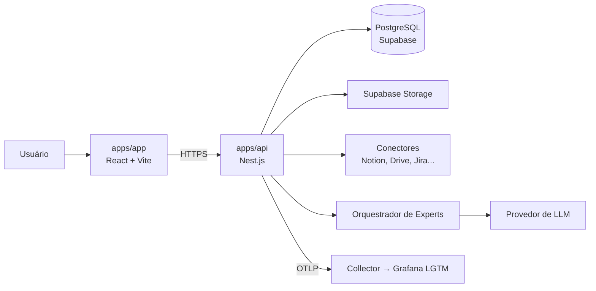

# Arquitetura

> **Público:** agentes de código e pessoas que precisam alterar estrutura, stack ou integrações.
> **Verificado contra o código em:** 2026-11-09.
> Leia `BUSINESS.md` para o contexto de produto e `DEVELOPMENT.md` para as regras de código.

## 1. Visão em uma frase

Monorepo que entrega uma SPA (`apps/app`) para operar experts de futebol, apoiada por uma API Nest.js (`apps/api`), Supabase local e observabilidade Grafana LGTM. A fundação técnica (spec `0000-foundation`) está implementada; **nenhuma feature de produto existe ainda**.

## 2. Estado atual (implementado)

| Caminho                        | O que é                                                 | Estado                                                                                                     |
| ------------------------------ | ------------------------------------------------------- | ---------------------------------------------------------------------------------------------------------- |
| `apps/app`                     | Cliente de produto em React + Vite (porta 5173)         | TanStack Router: `/` → `/app` (home placeholder), grupos `/auth/*` e `/app/*`, 404; `QueryClientProvider`  |
| `apps/api`                     | API Nest.js (porta 3002)                                | Prefixo `/api/v1`, `GET /api/v1/health`, envelope de erro, CORS (`APP_URL`); env validada; OTel; logs JSON |
| `apps/docs`                    | Site de documentação em Next.js (porta 3001)            | Página mínima                                                                                              |
| `packages/ui`                  | `@repo/ui`: Tailwind v4 + shadcn, tokens de `DESIGN.md` | Apenas `Button`; exports `./button`, `./styles.css`, `./lib/utils`                                         |
| `packages/typescript-config`   | tsconfig base (`strict`, `noUncheckedIndexedAccess`)    | `base`, `nestjs`, `nextjs`, `vite`, `react-library`                                                        |
| `supabase/`                    | Supabase local via CLI (`config.toml`, `migrations/`)   | Sem migrations de domínio                                                                                  |
| `docker-compose.yml`, `infra/` | Grafana, Loki, Tempo, Mimir e OTel Collector            | Datasources e dashboard mínimo provisionados                                                               |
| `scripts/`                     | `infra:up`, `infra:down`, `db:migrate` (Bun)            | Funcionais                                                                                                 |
| `e2e/`, `playwright.config.ts` | Testes E2E                                              | 1 teste da rota `/`                                                                                        |

```text
apps/
  app/    src/ (App.tsx, main.tsx, router.tsx, routes/, lib/supabase.ts, test/)
  api/    src/ (main.ts, bootstrap.ts, app.module.ts, common/, config/, health/, observability/) + test/
  docs/   app/ (rotas, layout, CSS Modules)
packages/
  ui/                 src/button.tsx, src/styles.css, src/lib/utils.ts, components.json
  typescript-config/  base.json, nestjs.json, nextjs.json, vite.json, react-library.json
```

**Não existem hoje:** modelo de domínio, tabelas e RLS, autenticação, upload/storage, conectores, orquestração de agentes, CI/CD e deploy.

### 2.1 Portas

| Serviço                    | Porta                                    |
| -------------------------- | ---------------------------------------- |
| `apps/app` (Vite)          | 5173                                     |
| `apps/docs` (Next.js)      | 3001                                     |
| `apps/api` (Nest.js)       | 3002                                     |
| Grafana                    | 3000                                     |
| Loki / Tempo / Mimir       | 3100 / 3200 / 9009                       |
| OTel Collector (OTLP)      | 4317 (gRPC), 4318 (HTTP), 13133 (health) |
| Supabase API / DB / Studio | 54321 / 54322 / 54323                    |

## 3. Stack

### 3.1 Instalada e utilizável

| Camada           | Tecnologia                                       | Versão (lockfile)       | Observação                                                     |
| ---------------- | ------------------------------------------------ | ----------------------- | -------------------------------------------------------------- |
| Runtime          | Node.js                                          | >= 24                   | `engines` da raiz                                              |
| Package manager  | Bun                                              | 1.4.4                   | `devEngines` da raiz                                           |
| Monorepo         | Turborepo                                        | 2.11.10                 | `turbo.json`                                                   |
| Cliente          | React + Vite                                     | 19.3.1 / 8.3.6          | `apps/app`; ADR 0001                                           |
| Docs             | Next.js                                          | 16.4.5                  | `apps/docs`, App Router                                        |
| API              | Nest.js                                          | 12.4.0                  | `apps/api`; `class-validator` para DTOs                        |
| Linguagem        | TypeScript                                       | 6.0.3                   | Config base estrita                                            |
| Estilo           | TailwindCSS (CSS-first) + shadcn/ui              | 4.3.5                   | Tokens em `packages/ui/src/styles.css`                         |
| Dados no cliente | TanStack Query / Table / Charts                  | 5.107.1 / 9.3.1 / 1.4.0 | Só Query tem uso (provider); `date-fns` 4.4.0 instalado        |
| Roteamento       | TanStack Router                                  | 1.170.46                | `apps/app`; rotas em código (`router.tsx`); ADR 0003           |
| Backend de dados | Supabase (`@supabase/supabase-js`)               | 2.119.0                 | Cliente em `apps/app/src/lib/supabase.ts`; sem fluxos          |
| Testes           | Vitest 5.1.0, Supertest 7.3.1, Playwright 1.65.0 | —                       | Ver `QA.md`                                                    |
| Lint / format    | OXLint 1.92.0, OXFmt 0.77.0                      | —                       | ADR 0002                                                       |
| Hooks            | lefthook 2.2.2 + lint-staged 17.6.0              | —                       | Instalar com `bun run hooks:install`; validados no commit raiz |
| Observabilidade  | OpenTelemetry SDK 0.301.0, pino 10.4.0           | —                       | Traces, métricas e logs via OTLP HTTP                          |
| Infra local      | Supabase CLI 3.0.0, Docker Compose               | —                       | Grafana LGTM + OTel Collector                                  |

### 3.2 Alvo (planejada, ainda não instalada)

| Camada | Tecnologia | Uso pretendido                |
| ------ | ---------- | ----------------------------- |
| Deploy | Vercel     | Apps e API (fora da fundação) |
| CI     | —          | Gates de `QA.md` em pipeline  |

**Regra:** só descreva como disponível o que estiver em `package.json` e puder ser executado. Ao instalar algo novo, atualize esta tabela e `QA.md`.

## 4. Arquitetura-alvo



`apps/app`, `apps/api`, Supabase local e o pipeline de observabilidade existem como fundação. Conectores, orquestrador e LLM são **alvo**. Não crie imports, variáveis de ambiente ou chamadas para serviços que ainda não existem.

### 4.1 Limites entre partes

| Parte         | Pode importar                                 | Não pode importar                           |
| ------------- | --------------------------------------------- | ------------------------------------------- |
| `apps/app`    | `@repo/ui`, seus próprios `features/`, `lib/` | `apps/docs`, `apps/api`, código de servidor |
| `apps/docs`   | seus próprios arquivos                        | `apps/app`, `apps/api`                      |
| `apps/api`    | seus módulos, `src/modules/shared`            | `apps/app`, `apps/docs`                     |
| `packages/ui` | React e utilitários de apresentação           | apps, regras de negócio, clients de API     |
| `packages/*`  | outros pacotes compartilhados                 | apps                                        |
| `domain`      | apenas TypeScript                             | framework, banco, HTTP, SDKs                |

### 4.2 Backend: camadas + vertical slices

Cada domínio é uma fatia vertical em `apps/api/src/modules/<dominio>/`, com as quatro camadas dentro dela:

| Camada           | Responsabilidade                                     | Exemplos                                                 |
| ---------------- | ---------------------------------------------------- | -------------------------------------------------------- |
| `domain`         | Entidades, value objects, regras, ports (interfaces) | `Expert`, `Connector`, `Demand`                          |
| `application`    | Casos de uso e orquestração                          | `CreateExpert`, `AskExpert`                              |
| `infrastructure` | Implementações concretas dos ports                   | Repositórios Supabase, clients de conectores, LLM, filas |
| `interface`      | Entrada/saída HTTP                                   | Controllers, DTOs, presenters, guards                    |

Hoje `apps/api/src` tem só `bootstrap.ts`, `common/` (envelope de erro, filtro e validação), `config/`, `health/`, `modules/email/` (spec `0002`) e `observability/`. Código compartilhado entre fatias vive em `apps/api/src/modules/shared` **somente** quando for estável e usado por dois ou mais módulos. Não crie `shared` preventivamente.

### 4.3 Frontend: composição

```text
apps/app/
  src/
    features/<dominio>/   # componentes, hooks e chamadas da fatia (a criar)
    lib/                  # clients, configuração e utilitários
    router.tsx, routes/   # árvore de rotas (grupos /auth e /app), layouts e páginas de composição
    main.tsx, App.tsx
```

- `App.tsx` compõe; não concentra regra de negócio.
- `features/<dominio>/` é a fatia vertical do frontend, criada junto com a primeira feature.
- Primitivos visuais vivem em `packages/ui`; composições específicas ficam na feature.
- O cliente é uma SPA: o browser fala com a API (`VITE_API_URL`); segredos nunca entram no bundle. Só variáveis `VITE_*` são públicas.

### 4.4 Observabilidade

A API carrega `observability/telemetry.ts` antes do Nest (`import` na primeira linha de `main.ts`) e exporta traces, métricas e logs por OTLP HTTP ao Collector (`OTEL_EXPORTER_OTLP_ENDPOINT`), que encaminha para Tempo, Mimir e Loki. Exportação é em lote com timeout (`OTEL_EXPORTER_OTLP_TIMEOUT`); se o Collector cair, a API continua respondendo.

Regras já aplicadas e que devem ser mantidas:

- Log por request via `pino-http` com `requestId` (aceita `x-request-id` ou gera UUID e devolve no header).
- O log de request registra **apenas** `id`, método, path (sem query string) e status. Não registre headers, IP, query ou corpo.
- O SDK não usa detectores de host/processo (`resourceDetectors: []`), para não exportar nome da máquina nem caminhos locais.
- `analytics` do Supabase está **desligado** em `supabase/config.toml`: o `vector` dele exige o daemon Docker em `tcp://localhost:2375` e fica reiniciando no Windows. Logs vão para o LGTM.

### 4.5 E-mail transacional (`apps/api/src/modules/email`)

Único ponto de saída de e-mail da API. Casos de uso importam **apenas** o barrel `modules/email/index.ts` (`EmailService`, `renderEmailLayout`, `html`, `EmailDeliveryError`) e nunca código de provedor; `email-boundaries.spec.ts` verifica isso.

| Camada           | Conteúdo                                                                                                                                                                             |
| ---------------- | ------------------------------------------------------------------------------------------------------------------------------------------------------------------------------------ |
| `domain`         | `EmailMessage`, `EmailDeliveryError` (códigos tipados, `retryable`), porta `EmailProvider`, `SafeHtml`/`html`/`escapeHtml`                                                           |
| `application`    | `EmailService` (`send` com timeout de 5 s por tentativa, até 3 tentativas com espera de 250 ms e 500 ms e prazo de 15 s; `dispatch` que nunca rejeita; `drain`), `renderEmailLayout` |
| `infrastructure` | Provedores `mailtrap` (Email Sandbox, fora de produção), `resend` (produção) e `capture` (testes), ambos por API HTTP com `fetch`; `parseEmailConfig`; logger                        |
| `interface`      | `GET/DELETE /api/v1/test-support/emails` (guard devolve 404 fora do `capture`)                                                                                                       |

- `EMAIL_PROVIDER` (`mailtrap`, `resend` ou `capture`), `EMAIL_FROM` e a credencial do provedor escolhido são validadas no boot (`validateEnvironment`). Com `NODE_ENV=production` só `resend` sobe.
- Logs: apenas `event` (`email_sent` ou `email_delivery_failed`), provedor, `purpose`, duração, tentativas e código de erro; nunca destinatário, assunto, corpo, token, link ou chave.
- Sem fila nem outbox: e-mail em andamento se perde se o processo cair (reenvio nas specs 0006 e 0009). `drain()` roda no desligamento gracioso.
- Decisão registrada no ADR `XXXX-0002-email-transacional-via-api-http` (número definitivo atribuído na integração).

## 5. Decisões já tomadas

| Decisão                                         | Motivo                                                            | Consequência                                             |
| ----------------------------------------------- | ----------------------------------------------------------------- | -------------------------------------------------------- |
| Monorepo com Turborepo e workspaces             | Compartilhar UI e tsconfig entre apps                             | Mudanças em pacotes exigem atenção a consumidores        |
| Cliente em Vite; `apps/docs` em Next.js         | Produto sem SSR e com API própria — ADR 0001                      | `apps/web` removido; sem Server Components no produto    |
| OXLint + OXFmt no lugar de ESLint + Prettier    | Baseline quebrado e stack-alvo — ADR 0002                         | Sem plugins ESLint; `tsc` é o gate de tipos              |
| Pacote `@repo/ui` compartilhado                 | Evitar duplicação de primitivos                                   | Contrato de exports (`@repo/ui/*`) precisa ser estável   |
| TypeScript estrito                              | Segurança de tipos em domínio rico                                | `any` e asserções não justificadas são proibidos         |
| Backend separado do cliente                     | API, conectores e jobs sem acoplar ao frontend                    | O cliente nunca acessa o banco com segredo               |
| Supabase local via CLI; Compose só para LGTM    | Evitar conflito entre Compose e o fluxo da CLI                    | `infra:up` orquestra os dois                             |
| API em `/api/v1`, rotas `/auth` e `/app`, en-US | Espaço de URLs e idioma estáveis antes da autenticação — ADR 0004 | Ver `DEVELOPMENT.md` §13; `APP_URL` é obrigatória na API |
| TanStack Router, rotas em código                | Combina com o stack TanStack — ADR 0003                           | Sem plugin de geração de rotas                           |

ADRs vivem em `./.adrs/` (`0001` a `0004`). Crie `./.adrs/NNNN-titulo.md` ao tomar decisões estruturais (template em `RULES.md`).

## 6. Dívidas e lacunas conhecidas

1. **Sem modelo de dados:** não há migrations, schema ou RLS; `supabase/migrations/` só tem `.gitkeep`.
2. **Sem autenticação:** nenhuma rota protegida ou sessão; `/app/*` e toda a API são públicas até a spec `0005` (`.plans/auth-breakdown.md`).
3. **Sem CI:** nenhum workflow de lint, tipos, build ou testes.
4. **Sem páginas de produto:** o roteador e os grupos `/auth/*` e `/app/*` existem, mas só há a home placeholder e a 404.
5. **Hooks e push sem automação em CI:** o repositório existe desde 2026-11-07 (`main`, `origin` = `https://github.com/brunolucildo/analytics-personas.git`, commit raiz `227e0ad`). Os hooks do `lefthook` só rodam depois de `bun run hooks:install` em cada clone e não há pipeline que repita os gates. O push exige login do Git Credential Manager na conta `brunolucildo`.
6. **`bun run lint` cobre só os workspaces:** `scripts/` e `e2e/` na raiz não são linted por esse comando.
7. **Imagens LGTM em `:latest`** e Grafana com `admin/admin`: aceitável só para uso local; fixe versões e troque credenciais antes de qualquer ambiente compartilhado.
8. **`supabase migration up --local`:** a CLI 3.x avisa que `--local` será removido na v4.
9. **TanStack Table/Charts e `date-fns`** estão instalados sem uso; a primeira tela com dados deve consumi-los ou removê-los.

## 7. Regras ao evoluir a arquitetura

- Adicione dependência na raiz somente se for ferramenta de todo o monorepo; caso contrário, instale no app/pacote consumidor.
- O browser fala com a API; segredos (`SUPABASE_SERVICE_ROLE_KEY`) ficam no servidor e nunca no bundle de `apps/app`.
- Conectores devem implementar uma interface comum (port) e ficar em `infrastructure`; nenhuma regra de domínio pode depender de Notion, Jira ou Google.
- O orquestrador de experts não deve conhecer detalhes de UI. Ele recebe uma demanda e devolve uma entrega rastreável às fontes.
- Toda integração externa precisa de timeout, retry com limite, tratamento de erro e logs sem PII.
- Antes de alterar `turbo.json`, leia `node_modules/turbo/docs/README.md` da versão instalada.
