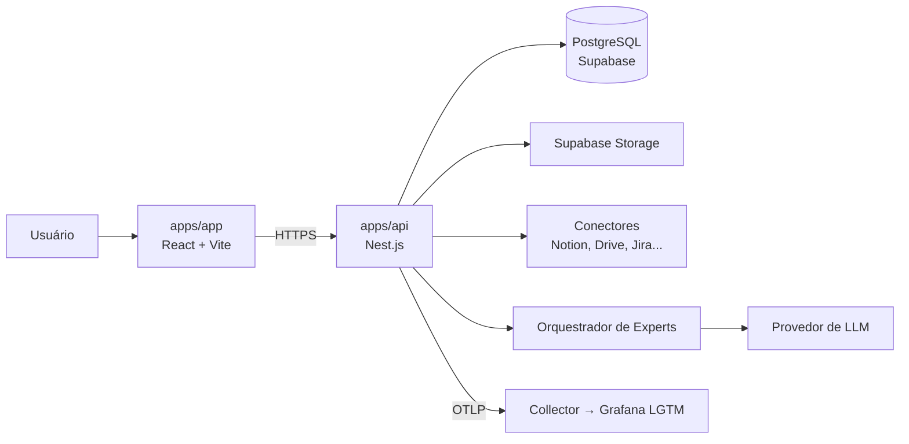

# Arquitetura

> **Público:** agentes de código e pessoas que precisam alterar estrutura, stack ou integrações.
> **Verificado contra o código em:** 2026-11-09.
> Leia `BUSINESS.md` para o contexto de produto e `DEVELOPMENT.md` para as regras de código.

## 1. Visão em uma frase

Monorepo que entrega uma SPA (`apps/app`) para operar experts de futebol, apoiada por uma API Nest.js (`apps/api`), Supabase local e observabilidade Grafana LGTM. A fundação técnica (spec `0000-foundation`) está implementada; a única feature de produto é o cadastro de conta (spec `0004`).

## 2. Estado atual (implementado)

| Caminho                        | O que é                                                 | Estado                                                                                                                                                                                                                                                                                                                                                                                                                                                           |
| ------------------------------ | ------------------------------------------------------- | ---------------------------------------------------------------------------------------------------------------------------------------------------------------------------------------------------------------------------------------------------------------------------------------------------------------------------------------------------------------------------------------------------------------------------------------------------------------- |
| `apps/app`                     | Cliente de produto em React + Vite (porta 5173)         | TanStack Router: `/` → `/app` (home placeholder), grupos `/auth/*` e `/app/*`, 404; `QueryClientProvider`; páginas `/auth/sign-in`, `/auth/sign-up`, `/auth/forgot-password`, `/auth/confirm-account`, `/auth/resend-confirmation` e `/auth/reset-password` (`features/auth/`) e `lib/api-client.ts`; `/app/*` exige sessão (guard) e a home mostra `Welcome, <nome>`                                                                                            |
| `apps/api`                     | API Nest.js (porta 3002)                                | Prefixo `/api/v1`, `GET /api/v1/health`, envelope de erro, CORS (`APP_URL`); env validada; OTel; logs JSON; `POST /api/v1/auth/sign-up`, `POST /api/v1/auth/sign-in`, `POST /api/v1/auth/forgot-password`, `POST /api/v1/auth/confirm-account`, `POST /api/v1/auth/resend-confirmation` e `POST /api/v1/auth/reset-password` (`modules/auth`); **fechada por padrão**: `AuthGuard` global, `@Public()`, `GET /api/v1/auth/session`, `POST /api/v1/auth/sign-out` |
| `apps/docs`                    | Site de documentação em Next.js (porta 3001)            | Página mínima                                                                                                                                                                                                                                                                                                                                                                                                                                                    |
| `packages/ui`                  | `@repo/ui`: Tailwind v4 + shadcn, tokens de `DESIGN.md` | `Button`, `Input` e `Label`; exports `./button`, `./input`, `./label`, `./styles.css`, `./lib/utils`                                                                                                                                                                                                                                                                                                                                                             |
| `packages/typescript-config`   | tsconfig base (`strict`, `noUncheckedIndexedAccess`)    | `base`, `nestjs`, `nextjs`, `vite`, `react-library`                                                                                                                                                                                                                                                                                                                                                                                                              |
| `supabase/`                    | Supabase local via CLI (`config.toml`, `migrations/`)   | Migrations `users`/`auth_tokens` (funções `auth_sign_up`, `auth_request_password_reset` e `auth_reset_password`) e `sessions` (função `auth_issue_session`), RLS sem policies                                                                                                                                                                                                                                                                                    |
| `docker-compose.yml`, `infra/` | Grafana, Loki, Tempo, Mimir e OTel Collector            | Datasources (com link log → trace e trace → logs) e dashboard "Rondo — Observabilidade da API" provisionado                                                                                                                                                                                                                                                                                                                                                      |
| `scripts/`                     | `infra:up`, `infra:down`, `db:migrate` (Bun)            | Funcionais                                                                                                                                                                                                                                                                                                                                                                                                                                                       |
| `e2e/`, `playwright.config.ts` | Testes E2E                                              | Rotas `/`, 404, `/auth/sign-in`, `/auth/sign-up`, `/auth/forgot-password`, `/auth/confirm-account`, `/auth/resend-confirmation` e `/auth/reset-password` (app e API reais, e-mail em `capture`)                                                                                                                                                                                                                                                                  |

```text
apps/
  app/    src/ (App.tsx, main.tsx, router.tsx, routes/, features/auth/, lib/api-client.ts, lib/supabase.ts, test/)
  api/    src/ (main.ts, bootstrap.ts, app.module.ts, common/, config/, health/, modules/{auth,email,rate-limit}/, observability/) + test/
  docs/   app/ (rotas, layout, CSS Modules)
packages/
  ui/                 src/{button,input,label}.tsx, src/styles.css, src/lib/utils.ts, components.json
  typescript-config/  base.json, nestjs.json, nextjs.json, vite.json, react-library.json
```

**Não existem hoje:** modelo de domínio além de `users`, `auth_tokens` e `sessions`, refresh token e bloqueio de conta por falhas, upload/storage, conectores, orquestração de agentes, CI/CD e deploy.

### 2.1 Portas

| Serviço                    | Porta                                    |
| -------------------------- | ---------------------------------------- |
| `apps/app` (Vite)          | 5173                                     |
| `apps/docs` (Next.js)      | 3001                                     |
| `apps/api` (Nest.js)       | 3002                                     |
| Grafana                    | 3000                                     |
| Loki / Tempo / Mimir       | 3100 / 3200 / 9009                       |
| OTel Collector (OTLP)      | 4317 (gRPC), 4318 (HTTP), 13133 (health) |
| Supabase API / DB / Studio | 54321 / 54322 / 54323                    |

## 3. Stack

### 3.1 Instalada e utilizável

| Camada           | Tecnologia                                       | Versão (lockfile)       | Observação                                                                                                      |
| ---------------- | ------------------------------------------------ | ----------------------- | --------------------------------------------------------------------------------------------------------------- |
| Runtime          | Node.js                                          | >= 24                   | `engines` da raiz                                                                                               |
| Package manager  | Bun                                              | 1.4.4                   | `devEngines` da raiz                                                                                            |
| Monorepo         | Turborepo                                        | 2.11.10                 | `turbo.json`                                                                                                    |
| Cliente          | React + Vite                                     | 19.3.1 / 8.3.6          | `apps/app`; ADR 0001                                                                                            |
| Docs             | Next.js                                          | 16.4.5                  | `apps/docs`, App Router                                                                                         |
| API              | Nest.js                                          | 12.4.0                  | `apps/api`; `class-validator` para DTOs                                                                         |
| Linguagem        | TypeScript                                       | 6.0.3                   | Config base estrita                                                                                             |
| Estilo           | TailwindCSS (CSS-first) + shadcn/ui              | 4.3.5                   | Tokens em `packages/ui/src/styles.css`                                                                          |
| Dados no cliente | TanStack Query / Table / Charts                  | 5.107.1 / 9.3.1 / 1.4.0 | Só Query tem uso (provider); `date-fns` 4.4.0 instalado                                                         |
| Roteamento       | TanStack Router                                  | 1.170.46                | `apps/app`; rotas em código (`router.tsx`); ADR 0003                                                            |
| JWT              | jose                                             | 6.2.17                  | `apps/api`, HS256; ver §4.7 e ADR da spec `0005`                                                                |
| Backend de dados | Supabase (`@supabase/supabase-js`)               | 2.119.0                 | Cliente em `apps/app/src/lib/supabase.ts` (sem fluxos); a API o usa com a service role em `modules/auth` (§4.6) |
| Testes           | Vitest 5.1.0, Supertest 7.3.1, Playwright 1.65.0 | —                       | Ver `QA.md`                                                                                                     |
| Lint / format    | OXLint 1.92.0, OXFmt 0.77.0                      | —                       | ADR 0002                                                                                                        |
| Hooks            | lefthook 2.2.2 + lint-staged 17.6.0              | —                       | Instalar com `bun run hooks:install`; validados no commit raiz                                                  |
| Observabilidade  | OpenTelemetry SDK 0.301.0, pino 10.4.0           | —                       | Traces, métricas e logs via OTLP HTTP                                                                           |
| Infra local      | Supabase CLI 3.0.0, Docker Compose               | —                       | Grafana LGTM + OTel Collector                                                                                   |

### 3.2 Alvo (planejada, ainda não instalada)

| Camada | Tecnologia | Uso pretendido                |
| ------ | ---------- | ----------------------------- |
| Deploy | Vercel     | Apps e API (fora da fundação) |
| CI     | —          | Gates de `QA.md` em pipeline  |

**Regra:** só descreva como disponível o que estiver em `package.json` e puder ser executado. Ao instalar algo novo, atualize esta tabela e `QA.md`.

## 4. Arquitetura-alvo



`apps/app`, `apps/api`, Supabase local e o pipeline de observabilidade existem como fundação. Conectores, orquestrador e LLM são **alvo**. Não crie imports, variáveis de ambiente ou chamadas para serviços que ainda não existem.

### 4.1 Limites entre partes

| Parte         | Pode importar                                 | Não pode importar                           |
| ------------- | --------------------------------------------- | ------------------------------------------- |
| `apps/app`    | `@repo/ui`, seus próprios `features/`, `lib/` | `apps/docs`, `apps/api`, código de servidor |
| `apps/docs`   | seus próprios arquivos                        | `apps/app`, `apps/api`                      |
| `apps/api`    | seus módulos, `src/modules/shared`            | `apps/app`, `apps/docs`                     |
| `packages/ui` | React e utilitários de apresentação           | apps, regras de negócio, clients de API     |
| `packages/*`  | outros pacotes compartilhados                 | apps                                        |
| `domain`      | apenas TypeScript                             | framework, banco, HTTP, SDKs                |

### 4.2 Backend: camadas + vertical slices

Cada domínio é uma fatia vertical em `apps/api/src/modules/<dominio>/`, com as quatro camadas dentro dela:

| Camada           | Responsabilidade                                     | Exemplos                                                     |
| ---------------- | ---------------------------------------------------- | ------------------------------------------------------------ |
| `domain`         | Entidades, value objects, regras, ports (interfaces) | `Expert`, `Connector`, `Demand`                              |
| `application`    | Casos de uso e orquestração                          | `CreateExpert`, `AskExpert`                                  |
| `infrastructure` | Implementações concretas dos ports                   | Repositórios Supabase, clients de conectores, LLM, filas     |
| `interface`      | Entrada/saída HTTP                                   | Request handlers (um por endpoint), DTOs, presenters, guards |

**Request handler por endpoint (ADR `0014`):** cada endpoint tem uma classe em `interface/request-handlers/<fluxo>.request-handler.ts` que injeta exatamente um caso de uso de `application/use-cases/<fluxo>.use-case.ts` (uma classe, um `execute`); o handler declara rota e decorators de borda, valida o DTO, traduz erros de domínio em `ApiException` e apresenta a resposta com um presenter. Serviços de capacidade reutilizável (`SessionService`, `EmailService`) ficam em `application/services/` e nunca representam um fluxo. Exemplo: `SignInRequestHandler` injeta `SignIn`, chama `execute({ email, password })`, mapeia `InvalidCredentialsError` em `401 INVALID_CREDENTIALS` e responde com `presentSession`.

Hoje `apps/api/src` tem só `bootstrap.ts`, `common/` (envelope de erro, filtro e validação), `config/`, `health/`, `modules/email/` (spec `0002`), `modules/rate-limit/` (spec `0003`), `modules/auth/` (spec `0004`) e `observability/`. Código compartilhado entre fatias vive em `apps/api/src/modules/shared` **somente** quando for estável e usado por dois ou mais módulos. Não crie `shared` preventivamente.

### 4.3 Frontend: composição

```text
apps/app/
  src/
    features/<dominio>/   # componentes, hooks e chamadas da fatia (a criar)
    lib/                  # clients, configuração e utilitários
    router.tsx, routes/   # árvore de rotas (grupos /auth e /app), layouts e páginas de composição
    main.tsx, App.tsx
```

- `App.tsx` compõe; não concentra regra de negócio.
- `features/<dominio>/` é a fatia vertical do frontend, criada junto com a primeira feature.
- Primitivos visuais vivem em `packages/ui`; composições específicas ficam na feature.
- O cliente é uma SPA: o browser fala com a API (`VITE_API_URL`); segredos nunca entram no bundle. Só variáveis `VITE_*` são públicas.

### 4.4 Observabilidade

A API carrega `observability/telemetry.ts` antes do Nest (`import` na primeira linha de `main.ts`) e exporta traces, métricas e logs por OTLP HTTP ao Collector (`OTEL_EXPORTER_OTLP_ENDPOINT`), que encaminha para Tempo, Mimir e Loki. Exportação é em lote com timeout (`OTEL_EXPORTER_OTLP_TIMEOUT`); se o Collector cair, a API continua respondendo.

Regras já aplicadas e que devem ser mantidas:

- Log por request via `pino-http` com `requestId` (aceita `x-request-id` ou gera UUID e devolve no header).
- O log de request registra **apenas** `id`, método, path (sem query string) e status. Não registre headers, IP, query ou corpo.
- O SDK não usa detectores de host/processo (`resourceDetectors: []`), para não exportar nome da máquina nem caminhos locais.
- `analytics` do Supabase está **desligado** em `supabase/config.toml`: o `vector` dele exige o daemon Docker em `tcp://localhost:2375` e fica reiniciando no Windows. Logs vão para o LGTM.

**Catálogo de sinais (spec `0011`, ADR `0010`).** As métricas ficam em **push OTLP**: não existe `GET /metrics` nem raspagem. Os nomes e labels abaixo são contrato dos dashboards em `infra/grafana/dashboards/` (`api-observability.json`); mudar um deles exige mudar o dashboard e o teste `grafana-assets.spec.ts`.

| Sinal   | Nome (no backend)                                                                                                                                                                                                                                                                                                              | Dimensões / campos                                                                                                                                           | Onde nasce                                                                                                              |
| ------- | ------------------------------------------------------------------------------------------------------------------------------------------------------------------------------------------------------------------------------------------------------------------------------------------------------------------------------ | ------------------------------------------------------------------------------------------------------------------------------------------------------------ | ----------------------------------------------------------------------------------------------------------------------- |
| Métrica | `http_server_request_duration_seconds_*` (automática)                                                                                                                                                                                                                                                                          | `http_route` (template da rota ou `unmatched`), `http_request_method`, status                                                                                | `observability/http-route.ts`, primeiro middleware de `configureApp` (antes do CORS, para cobrir o preflight)           |
| Métrica | `auth_operations_total` (contador `auth.operations`)                                                                                                                                                                                                                                                                           | `operation`, `outcome` (`success`/`failure`), `reason`                                                                                                       | `modules/auth/interface/auth-telemetry.middleware.ts`: uma contagem por tentativa, quando a resposta termina            |
| Métrica | `auth_operation_duration_seconds_*` (histograma `auth.operation.duration`)                                                                                                                                                                                                                                                     | `operation`, `outcome`                                                                                                                                       | o mesmo middleware                                                                                                      |
| Métrica | `auth_hash_active` e `auth_hash_queued` (gauges), `auth_hash_queue_wait_seconds_*` (histograma), `auth_hash_rejected_total` (contador)                                                                                                                                                                                         | sem labels                                                                                                                                                   | `modules/auth/infrastructure/hash-limiter.ts` (`HashLimiter`)                                                           |
| Span    | `auth.<operation>`, filho do span HTTP                                                                                                                                                                                                                                                                                         | `auth.operation`, `auth.outcome`, `auth.error_code` (só na falha); status `ERROR` na falha                                                                   | `traceAuthOperation` (`observability/auth-telemetry.ts`), chamado pelo request handler do fluxo em volta do caso de uso |
| Log     | `event: "auth_operation"` (nível `info` no sucesso, `warn` na falha)                                                                                                                                                                                                                                                           | `operation`, `outcome`, `reason`, `requestId`, mais `trace_id` e `span_id` do pino                                                                           | o mesmo middleware                                                                                                      |
| Métrica | `db_client_operation_duration_seconds_*` (histograma `db.client.operation.duration`)                                                                                                                                                                                                                                           | `db_operation_name`, `db_collection_name` (tabela) ou `db_stored_procedure_name` (função SQL), `error_type` (só em falha)                                    | `observability/db-telemetry.ts`: `fetch` do `supabase-js`, ligado no `createClient` do `auth.module`                    |
| Span    | `<operação> <tabela ou função>` (CLIENT), filho do span ativo (`auth.*`)                                                                                                                                                                                                                                                       | `db.system.name`, `db.operation.name`, `db.collection.name` ou `db.stored_procedure.name`, `db.response.status_code`, `error.type`; `ERROR` só em 5xx e rede | o mesmo `fetch`                                                                                                         |
| Log     | `event: "db_operation_failed"` (`warn`)                                                                                                                                                                                                                                                                                        | `operation`, `collection` ou `procedure`, `errorType`, mais `trace_id` e `span_id`                                                                           | o mesmo `fetch`, só em 5xx e falha de rede                                                                              |
| Métrica | `postgresql_*` (`job="rondo-postgres"`): `postgresql_backends`, `postgresql_connection_max`, `postgresql_commits_total`, `postgresql_rollbacks_total`, `postgresql_deadlocks_total`, `postgresql_blocks_read_total`, `postgresql_db_size_bytes`, `postgresql_rows`, `postgresql_table_size_bytes`, `postgresql_database_locks` | `database`, `table` (`schema.tabela`), `state`, `source`, `operation`, `mode`                                                                                | OTel Collector, receiver `postgresql` (`infra/otel/otel-collector-config.yaml`)                                         |

- **`operation`:** `sign_up`, `confirm_account`, `sign_in`, `sign_out`, `forgot_password`, `reset_password`, `resend_confirmation`.
- **`reason`:** `none` no sucesso; na falha, o `code` do envelope de erro em minúsculas, num conjunto **fechado**: `validation_failed`, `rate_limited`, `unauthenticated`, `email_already_registered`, `invalid_credentials`, `email_not_confirmed`, `token_invalid_or_expired`, `internal_error`, `service_busy`; qualquer outro vira `request_failed`. A lista vive em `AUTH_FAILURE_REASONS`.
- **Contagem única:** validação (400), limite (429) e sessão (401) respondem antes do controller, então a contagem fica no middleware de app, que lê o status e o `code` que o `AllExceptionsFilter` guarda em `response.locals`. Essas recusas contam, mas não têm span `auth.*` (o span HTTP já carrega o status).
- **Anti-enumeração:** `forgot_password` e `resend_confirmation` respondem 202 com ou sem conta e registram o mesmo resultado; nenhum sinal revela se um e-mail existe.
- **Sem PII:** nenhum e-mail, nome, senha, token, link, IP, `userId` ou `sid` em label, atributo de span ou campo de log; o span de falha leva só o código de erro, nunca a mensagem da exceção. `test/auth-observability.int-spec.ts` falha se um valor sentinela vazar.
- **Rota nas métricas:** o `instrumentation-http` lê `route` do metadado RPC ao fechar a resposta, mas a instrumentação do Express 5 não o preenche; por isso o middleware grava `req.baseUrl + req.route.path` (ou `unmatched`, inclusive para a rota _catch-all_ do Nest) no `finish`. Sem o SDK ele não faz nada.
- **Grafana:** o datasource Loki tem um _derived field_ sobre `trace_id` (abre o trace no Tempo) e o Tempo tem _trace to logs_ para o Loki; ambos provisionados em `infra/grafana/provisioning/datasources/datasources.yaml`. O Loki local guarda 24 h.
- **Banco (spec `0013`, ADR `0011`):** a API fala com o Postgres só por `supabase-js` (PostgREST), então o `createClient` recebe `global.fetch = createInstrumentedFetch()`. A operação e o alvo saem do **path** (`GET /rest/v1/users` vira `select users`; `POST /rest/v1/rpc/auth_sign_up` vira `rpc auth_sign_up`); nome fora de `[a-z_][a-z0-9_]{0,62}` vira `unknown`. **Nunca** a query string (o filtro do PostgREST leva e-mail e `sid`), o corpo ou os headers. `406` (`maybeSingle()` sem linha) e `409` são fluxo normal: contam em `error_type`, mas não marcam o span nem geram log. A duração vai até os headers da resposta.
- **Servidor Postgres:** o Collector lê o Supabase **local** (`host.docker.internal:54322`, usuário `postgres`) a cada 15 s; `POSTGRES_ENDPOINT`, `POSTGRES_USER` e `POSTGRES_PASSWORD` sobrescrevem. Em outro banco use um usuário com o papel `pg_monitor`. Se a API apontar para um Supabase hospedado, as operações dele aparecem, mas as métricas do servidor continuam sendo as do banco local.
- **Spans sem query string e sem IP:** `observability/span-redaction.ts` sobrescreve `url.full` (sem query) e `url.query` (vazio) nas chamadas de saída (`startSpanHook` do undici) e esvazia `url.query` e `client.address` nos spans de entrada (`requestHook` do HTTP). Os limites dos histogramas de duração (`DURATION_BUCKETS_SECONDS`) são em **segundos**; o padrão do OpenTelemetry é em ms.
- **`instance` por processo:** o resource da API leva `service.instance.id` (um UUID aleatório por processo, sem dado pessoal), que o Mimir expõe como o label `instance`. Sem ele, dois processos da API (dev e teste de carga, ou duas réplicas) escrevem nas **mesmas séries** e os contadores se sobrescrevem, o que distorce `rate()` e as médias de gauge. Cada reinício gera um `instance` novo; consulte sempre com `sum`, `max` ou `avg` por cima.
- **Contador OTLP e `increase()`:** o contador só nasce no primeiro incremento, então `increase()` e `rate()` perdem o primeiro evento de uma série nova. Para eventos raros (5xx, falha de banco, falha de e-mail, 429, falhas de auth) o dashboard e os alertas contam **logs do Loki**; séries contínuas (latência, vazão) usam métricas.
- **Hash de senha com orçamento (spec `0015`, ADR `0013`):** o argon2id (64 MiB, 3 passes, 4 lanes) é limitado por memória (~33 hashes por segundo na máquina de desenvolvimento, não importa a concorrência) e roda no pool de threads do libuv, que a verificação do JWT, o `randomBytes` e o `fetch` ao PostgREST também usam: sem controle, a fila dos hashes atrasa todos eles (medido: `jwtVerify` de 0,3 ms para 1.252 ms). O `HashLimiter` mantém **no máximo `AUTH_HASH_CONCURRENCY` hashes em voo** (padrão: `UV_THREADPOOL_SIZE` menos 1, mínimo 1; o pool padrão tem 4), enfileira o excedente em ordem de chegada até **`AUTH_HASH_QUEUE_LIMIT`** (padrão 64) e, com a fila cheia, **recusa na hora com `503 SERVICE_BUSY`** e `Retry-After`, sem executar o hash. Toda chamada ao argon2 passa por ele (hash no sign-up e no reset; verificação no sign-in, inclusive a do e-mail inexistente). O 503 é uma recusa deliberada: o filtro de exceções não o registra como `unhandled_exception`.
- **Sign-in por IP:** a política `sign-in-ip` (60 por 10 min por IP, sem e-mail) é avaliada antes da por IP e e-mail, porque esta nunca barra um IP que troca de e-mail a cada tentativa e cada tentativa custa um hash. `@RateLimit` aceita várias políticas e a primeira que estoura responde 429.
- **Alertas (spec `0012`):** 19 regras em `infra/grafana/provisioning/alerting/rondo-alerts.yaml` (grupos `rondo-api`, `rondo-auth`, `rondo-dependencias`, `rondo-postgres`), na pasta "Rondo". Sem dados é normal (`noDataState: OK`); API e Postgres parados são detectados por `absent_over_time`. Não há contact point: o estado só aparece na interface. Alteração feita pela interface ou pela API do Grafana se perde com o volume; edite o YAML e rode `docker compose restart grafana`.

### 4.5 E-mail transacional (`apps/api/src/modules/email`)

Único ponto de saída de e-mail da API. Casos de uso importam **apenas** o barrel `modules/email/index.ts` (`EmailService`, `renderEmailLayout`, `html`, `EmailDeliveryError`) e nunca código de provedor; `email-boundaries.spec.ts` verifica isso. Os helpers de captura para testes (`getCapturedEmails`, `clearCapturedEmails`, `EMAIL_PROVIDER`) saem de `modules/email/testing/index.ts`, não do barrel público.

| Camada           | Conteúdo                                                                                                                                                                                                                                                       |
| ---------------- | -------------------------------------------------------------------------------------------------------------------------------------------------------------------------------------------------------------------------------------------------------------- |
| `domain`         | `EmailMessage`, `EmailDeliveryError` (códigos tipados, `retryable`), porta `EmailProvider`, `EmailConfig`/`parseEmailConfig`, read model `CapturedEmail` e port `CapturedEmailRepository`, `SafeHtml`/`html`/`escapeHtml`                                      |
| `application`    | `EmailService` (`send` com timeout de 5 s por tentativa, até 3 tentativas com espera de 250 ms e 500 ms e prazo de 15 s; `dispatch` que nunca rejeita; `drain`), `renderEmailLayout`; casos de uso `ListCapturedEmails` e `ClearCapturedEmails` (`use-cases/`) |
| `infrastructure` | Provedores `mailtrap` (Email Sandbox, fora de produção), `resend` (produção) e `capture` (testes), ambos por API HTTP com `fetch`; `CapturedEmailStore` (implementa `CapturedEmailRepository`); logger                                                         |
| `interface`      | `ListCapturedEmailsRequestHandler` (`GET /api/v1/test-support/emails`) e `ClearCapturedEmailsRequestHandler` (`DELETE`), com `CaptureOnlyGuard` (404 fora do `capture`)                                                                                        |

- `EMAIL_PROVIDER` (`mailtrap`, `resend` ou `capture`), `EMAIL_FROM` e a credencial do provedor escolhido são validadas no boot (`validateEnvironment`). Com `NODE_ENV=production` só `resend` sobe.
- Logs: apenas `event` (`email_sent` ou `email_delivery_failed`), provedor, `purpose`, duração, tentativas e código de erro; nunca destinatário, assunto, corpo, token, link ou chave.
- Sem fila nem outbox: e-mail em andamento se perde se o processo cair (reenvio nas specs 0006 e 0009). `drain()` roda no desligamento gracioso.
- Decisão registrada no ADR `0006-email-transacional-via-api-http`.

### 4.6 Autenticação e acesso a dados (`apps/api/src/modules/auth`, spec `0004`)

Primeira fatia de produto e referência das próximas specs de auth (`0005` a `0010`). Identidade própria da API, sem Supabase Auth (ADR 0007); acesso ao banco por `supabase-js` com a service role e funções SQL por RPC (ADR 0008).

| Camada           | Conteúdo                                                                                                                                                                                                                                                                 |
| ---------------- | ------------------------------------------------------------------------------------------------------------------------------------------------------------------------------------------------------------------------------------------------------------------------ |
| `domain`         | `auth-rules` (limites, `normalizeEmail`, `normalizeName`, TTL de 24 h), `EmailAlreadyRegisteredError`, ports (`UserRepository`, `PasswordHasher`, `TokenGenerator`, `TokenHasher`, `ConfirmationMailer`), `HashCapacityExceededError`                                    |
| `application`    | `use-cases/sign-up.use-case.ts` (`SignUp`): hash Argon2id, token, `createWithConfirmationToken`, depois o e-mail (`dispatch`, depois do commit)                                                                                                                          |
| `infrastructure` | `SupabaseUserRepository` (RPC `auth_sign_up`), `Argon2PasswordHasher`, `CryptoTokenGenerator` (256 bits, SHA-256 em hex), `CryptoTokenHasher`, `HashLimiter` (lança `HashCapacityExceededError`, sem conhecer HTTP), `EmailServiceConfirmationMailer`, `DataAccessError` |
| `interface`      | `SignUpRequestHandler` (`POST /api/v1/auth/sign-up`, `@RateLimit('sign-up')`), `SignUpDto` (`class-validator`; `@SameAs`), mapeamento do erro de domínio para `409 EMAIL_ALREADY_REGISTERED` e de `HashCapacityExceededError` para `503 SERVICE_BUSY`                    |

**Banco** (migration `supabase/migrations/20261109200000_create_users_and_auth_tokens.sql`):

- `users` (`id`, `first_name`, `last_name`, `email` único e já normalizado, `password_hash`, `email_confirmed_at` nulo = não confirmada, `created_at`, `updated_at` com gatilho) e `auth_tokens` (`id`, `user_id` com `on delete cascade`, `type` `email_confirmation` | `password_reset`, `token_hash` único, `expires_at`, `used_at`, `created_at`). Índices: `users_email_key`, `auth_tokens_token_hash_key`, `auth_tokens_user_id_type_idx`.
- RLS **ligada e sem policies**; `revoke all` de `anon` e `authenticated`. Só a API (service role) lê e escreve.
- `auth_sign_up(...)` cria usuário e token numa transação com `on conflict (email) do nothing`: devolve o `uuid` ou `null` (e-mail repetido); cadastros simultâneos do mesmo e-mail resolvem no índice único, sem 500. `execute` revogado de `public`, `anon` e `authenticated`; concedido só a `service_role`. Funções novas seguem a mesma regra.
- Rollback: SQL no comentário da migration (apaga todas as contas).
- `auth_request_password_reset(p_email, p_token_hash, p_token_expires_at)` (migration `20261109220000_add_auth_request_password_reset.sql`, spec `0009`): para conta **confirmada**, trava a linha do usuário (`for update`), marca como usadas todas as `password_reset` ainda não usadas e insere a nova; devolve o primeiro nome, ou `null` quando não há ação (e-mail inexistente ou conta não confirmada). A trava serializa pedidos simultâneos: o usuário nunca tem dois tokens de reset válidos. Mesma regra de `execute` (só `service_role`).
- `auth_confirm_account(p_token_hash)` e `auth_resend_confirmation(p_email, p_token_hash, p_token_expires_at)` (migration `20261109230000_add_auth_confirm_account.sql`, spec `0006`): a primeira consome o token `email_confirmation` com um único `update ... where used_at is null and expires_at > now()` (sob concorrência o segundo `update` não acha linha: uma resposta 200 e uma 400) e preenche `users.email_confirmed_at` (sem sobrescrever); devolve o id do usuário ou `null` para token desconhecido, expirado, usado ou de outro tipo. A segunda, para conta **não confirmada**, trava o usuário (`for update`), invalida as `email_confirmation` ainda não usadas e insere a nova; devolve o primeiro nome ou `null`. Mesma regra de `execute` (só `service_role`).

**Esqueci a senha (spec `0009`):** `RequestPasswordReset` (`application`) usa as ports `PasswordResetRepository` e `PasswordResetMailer` (`domain/password-reset-ports.ts`), `SupabasePasswordResetRepository` (RPC) e `EmailServicePasswordResetMailer` (`dispatch`, em segundo plano, depois do commit; TTL de 1 h em `PASSWORD_RESET_TOKEN_TTL_MS`). `POST /api/v1/auth/forgot-password` (`@RateLimit('forgot-password')`) responde sempre `202 {}`: o caso de uso não devolve nada, então o request handler não consegue distinguir conta confirmada, não confirmada e inexistente. A falha do provedor de e-mail só aparece no log e não muda a resposta nem o tempo.

**Confirmação de conta (spec `0006`):** `ConfirmAccount` (`application`) faz o hash do token, chama `ConfirmationRepository.confirmByTokenHash` (RPC `auth_confirm_account`) e, só se o token foi consumido, `SessionService.issue` (a sessão anterior é revogada); token ruim vira `InvalidConfirmationTokenError`, que o request handler traduz em `400 TOKEN_INVALID_OR_EXPIRED` sem distinguir o motivo. `POST /api/v1/auth/confirm-account` (`@Public()`, `@RateLimit('confirm-account')`) responde `200` com a resposta de sessão (`presentSession`) e nunca por `GET`. `ResendConfirmation` usa `renewForUnconfirmedUser` (RPC `auth_resend_confirmation`) e o `ConfirmationMailer` do cadastro (mesmo template, em segundo plano); `POST /api/v1/auth/resend-confirmation` (`@RateLimit('resend-confirmation')`) responde sempre `202 {}`, com conta não confirmada, confirmada ou inexistente. No SPA, `ConfirmAccountPage` chama a API uma única vez por visita (um `useRef`, que sobrevive ao StrictMode), grava o token no `onSuccess` do `useConfirmAccount` e vai para `/app`.

- `auth_reset_password(p_token_hash, p_password_hash)` (migration `20261109250000_add_auth_reset_password.sql`, spec `0010`): numa transação, consome o token `password_reset` (`update ... where used_at is null and expires_at > now() returning`, o que garante uso único sob concorrência), grava o novo hash em `users`, marca como usados os demais tokens `password_reset` do usuário e **revoga todas as sessões ativas** do usuário. Devolve `user_id`, `first_name` e `email`, ou nenhuma linha quando o token é desconhecido, expirado, usado ou de outro tipo. Mesma regra de `execute` (só `service_role`).

**Redefinir a senha (spec `0010`):** `ResetPassword` (`application`) calcula o hash Argon2id (antes de tocar no token) e chama `PasswordResetRepository.resetByTokenHash` (RPC `auth_reset_password`); só depois do commit despacha o e-mail "Your Rondo password was changed" por `PasswordChangedMailer` (`dispatch`, em segundo plano; falha só no log). `POST /api/v1/auth/reset-password` (`@Public()`, `@RateLimit('reset-password')`) responde `204`, ou `400 VALIDATION_FAILED` (antes de usar o token) e `400 TOKEN_INVALID_OR_EXPIRED` (um só código para token desconhecido, expirado, usado ou de outro tipo); não abre sessão. A revogação das sessões fica na própria função SQL, e não numa chamada posterior ao `SessionService`, para que uma falha entre a troca da senha e a revogação nunca deixe uma sessão antiga viva. No SPA, `/auth/reset-password` lê o token da URL, guarda só em memória e o remove do endereço (`replace`) ao carregar; recarregar mostra o link inválido. `index.html` tem `<meta name="referrer" content="no-referrer">`.

**Sign-in (spec `0007`):** `SignIn` (`application`) usa as ports `CredentialsRepository` (`SupabaseCredentialsRepository`: uma leitura de `users` com a service role, sem função SQL, pois não há atomicidade a garantir), `PasswordVerifier` (`Argon2PasswordVerifier`) e `NewSessionMailer` (`EmailServiceNewSessionMailer`, `dispatch` em segundo plano, depois da sessão aberta), mais o `SessionService.issue` (a sessão anterior é revogada). A senha é sempre verificada, inclusive quando o e-mail não tem conta (o verificador usa um hash Argon2id "fantasma" criado uma vez), e só depois a conta não confirmada é revelada: e-mail inexistente e senha errada viram `InvalidCredentialsError` (`401 INVALID_CREDENTIALS`, resposta idêntica), senha certa com conta não confirmada vira `EmailNotConfirmedError` (`403 EMAIL_NOT_CONFIRMED`). `POST /api/v1/auth/sign-in` (`@Public()`, `@RateLimit('sign-in')`) responde `200` com a resposta de sessão (`presentSession`). O DTO só exige senha de texto, não vazia e com até 128 caracteres: senha curta é senha errada (401), não erro de validação. O e-mail "New sign-in to Rondo" traz só primeiro nome, data e hora em UTC, o aviso de que a sessão anterior foi encerrada e o link `${APP_URL}/auth/forgot-password` (sem IP, dispositivo, token ou senha). No SPA, `SignInPage` guarda o token e põe o usuário no cache de `useSession` no `onSuccess` do `useSignIn` e vai para `/app`; em erro limpa a senha.
**Regras que as specs seguintes mantêm:** senha só como hash Argon2id; tokens de link só como hash SHA-256; `DataAccessError` tem mensagem fixa (mensagens do Postgres podem repetir o e-mail); nada de senha, token, link, e-mail ou IP em log; o request handler não acessa o banco; cada endpoint tem o seu handler e o seu caso de uso (ADR `0014`); `MIN_JWT_SECRET_LENGTH` fica em `apps/api/src/config/auth-secret.ts`.

**SPA:** `lib/api-client.ts` (base `${VITE_API_URL}/api/v1`, JSON, erro tipado `ApiError { status, code, message, details }`, `status` 0 e `NETWORK_ERROR` quando a rede falha) e `features/auth/` (página, validação por função pura, `useMutation` do TanStack Query).

### 4.7 Sessão e proteção de rotas (spec `0005`)

Bearer JWT cujo `sid` é conferido no banco a cada request; **sessão única por usuário**; **API fechada por padrão** (ADR `0009-modelo-de-sessao-jwt-com-sid-no-banco`). Mesmo módulo `modules/auth`.

| Camada           | Conteúdo                                                                                                                                                                                                                                                                                                                                                                |
| ---------------- | ----------------------------------------------------------------------------------------------------------------------------------------------------------------------------------------------------------------------------------------------------------------------------------------------------------------------------------------------------------------------- |
| `domain`         | `session-rules` (7 dias, `isUuid`), `session-ports` (`SessionRepository`, `AccessTokenSigner`, `SessionUser`, `IssuedSession`, `ActiveSession`), `SessionUserNotFoundError`                                                                                                                                                                                             |
| `application`    | `services/session.service.ts` (`SessionService`, capacidade usada pelos casos de uso e pelo `AuthGuard`): `issue(userId)` (devolve `{accessToken, expiresAt, user}`), `validate(sid)`, `authenticate(token)` (assinatura, depois sessão no banco e `sub` igual ao dono), `revoke(sid)`                                                                                  |
| `infrastructure` | `JoseAccessTokenSigner` (HS256, `sub` e `sid` precisam ser UUID), `SupabaseSessionRepository` (RPC `auth_issue_session`; leitura de `sessions` com o usuário; revogação)                                                                                                                                                                                                |
| `interface`      | `AuthGuard` (global, `APP_GUARD`, em `guards/`), `@CurrentSession()`, `presentSession`/`presentUser`, `GetSessionRequestHandler` (`GET /api/v1/auth/session`, caso de uso `GetSession`), `SignOutRequestHandler` (`POST /api/v1/auth/sign-out`, 204; caso de uso `SignOut` revoga o `sid` de `@CurrentSession()`); `@Public()` vive em `src/common/public.decorator.ts` |

- **Banco** (`supabase/migrations/20261109210000_create_sessions.sql`): `sessions` (`id` = `sid`, `user_id` com `on delete cascade`, `created_at`, `expires_at`, `revoked_at`), índice único parcial `sessions_user_id_active_key` (uma ativa por usuário), RLS ligada e sem policies, `revoke all` de `anon`/`authenticated`. `auth_issue_session(p_user_id, p_expires_at)` trava a linha do usuário, revoga a ativa e insere a nova na mesma transação; devolve a sessão e os campos públicos do usuário (ou nenhuma linha se o usuário não existe). `execute` só para `service_role`. Rollback no comentário da migration.
- **Contrato:** token `{sub, sid, iat, exp}` (sem PII); resposta de sessão `{accessToken, expiresAt, user:{id, firstName, lastName, email}}` (use `presentSession` nos endpoints de 0006 e 0007); `401 UNAUTHENTICATED` ("Authentication required.") para qualquer problema com o token, sem dizer qual. `AUTH_JWT_SECRET` (>= 32 caracteres) é obrigatória: a API não sobe sem ela.
- **Ordem dos guards:** `RateLimitModule` antes de `AuthModule` em `AppModule`: o limite roda antes da autenticação.
- **SPA:** `lib/access-token.ts` (`access_token` no `localStorage`, `try/catch`, cópia em memória), `api-client` (`get`, `Authorization: Bearer`, 401 `UNAUTHENTICATED` limpa o token), `lib/query-client.ts` (um 401 em qualquer query ou mutation leva a `/auth/sign-in` fora das páginas de auth), `features/auth/use-session.ts` (`GET /auth/session`; o token faz parte da chave), `auth-redirect.ts` (função pura de `/auth/*`), `session-states.tsx` (`role="status"` e "We couldn't verify your session."/`Try again`), `use-sign-out.ts` e `sign-out-button.tsx` (botão `Sign out` na home; em `onSettled`, qualquer resultado limpa o token e o cache e vai a `/auth/sign-in`). Guard de `/app`: `beforeLoad` (sem token: `/auth/sign-in` sem chamar a API) mais `AppLayout`. `AuthLayout` manda quem tem sessão para `/app`, exceto `confirm-account` e `reset-password`.
- **Para 0006, 0007 e 0008:** emita com `SessionService.issue(userId)` e responda `presentSession(...)`; no SPA, grave com `setAccessToken` e navegue para `/app` (a chave da query muda com o token, então nada de cache antigo é reaproveitado); sign-out: `SessionService.revoke(sid)` no servidor (o `sid` vem de `@CurrentSession()`) e `clearAccessToken()` no cliente.

## 5. Decisões já tomadas

| Decisão                                         | Motivo                                                            | Consequência                                                                    |
| ----------------------------------------------- | ----------------------------------------------------------------- | ------------------------------------------------------------------------------- |
| Monorepo com Turborepo e workspaces             | Compartilhar UI e tsconfig entre apps                             | Mudanças em pacotes exigem atenção a consumidores                               |
| Cliente em Vite; `apps/docs` em Next.js         | Produto sem SSR e com API própria — ADR 0001                      | `apps/web` removido; sem Server Components no produto                           |
| OXLint + OXFmt no lugar de ESLint + Prettier    | Baseline quebrado e stack-alvo — ADR 0002                         | Sem plugins ESLint; `tsc` é o gate de tipos                                     |
| Pacote `@repo/ui` compartilhado                 | Evitar duplicação de primitivos                                   | Contrato de exports (`@repo/ui/*`) precisa ser estável                          |
| TypeScript estrito                              | Segurança de tipos em domínio rico                                | `any` e asserções não justificadas são proibidos                                |
| Backend separado do cliente                     | API, conectores e jobs sem acoplar ao frontend                    | O cliente nunca acessa o banco com segredo                                      |
| Supabase local via CLI; Compose só para LGTM    | Evitar conflito entre Compose e o fluxo da CLI                    | `infra:up` orquestra os dois                                                    |
| API em `/api/v1`, rotas `/auth` e `/app`, en-US | Espaço de URLs e idioma estáveis antes da autenticação — ADR 0004 | Ver `DEVELOPMENT.md` §13; `APP_URL` é obrigatória na API                        |
| TanStack Router, rotas em código                | Combina com o stack TanStack — ADR 0003                           | Sem plugin de geração de rotas                                                  |
| Limite de requisições próprio, em memória       | Chave por rota + IP + e-mail e envelope próprio — ADR 0005        | Sem `@nestjs/throttler`; instância única; ver §6 item 10                        |
| Auth própria na API (Nest + Postgres), Argon2id | Sessão única, e-mails próprios e identidade no domínio — ADR 0007 | Sem Supabase Auth; segurança de credenciais é nossa (§4.6)                      |
| `supabase-js` (service role) + funções RPC      | Decisão do solicitante; transação no banco — ADR 0008             | RLS sem policies; `execute` revogado de `anon`/`authenticated`                  |
| Sessão: bearer JWT com `sid` conferido no banco | Sessão única e revogação imediata — ADR 0009                      | API fechada por padrão; uma leitura por request; token em `localStorage` (§4.7) |

ADRs vivem em `./.adrs/` (`0001` a `0006`; os dois da spec `0004` entram com o número definido na integração). Crie `./.adrs/NNNN-titulo.md` ao tomar decisões estruturais (template em `RULES.md`).

## 6. Dívidas e lacunas conhecidas

1. **Modelo de dados mínimo:** só `users` e `auth_tokens` (spec `0004`); sem tabelas de clube, expert ou conector. Não há rollback automático: o SQL fica no comentário da migration.
2. **Autenticação:** existem o cadastro (spec `0004`), a sessão com a proteção de rotas (spec `0005`: API e `/app/*` fechadas), a confirmação de conta (spec `0006`), que já abre a sessão, e o sign-out (spec `0008`: `POST /api/v1/auth/sign-out` e o botão na home) o sign-in (spec `0007`: `POST /api/v1/auth/sign-in`, a página `/auth/sign-in` e o e-mail de nova sessão) e a redefinição de senha (specs `0009` e `0010`: `POST /api/v1/auth/forgot-password`, `POST /api/v1/auth/reset-password`, as duas páginas e o e-mail de senha alterada; o reset revoga as sessões e não abre uma nova). Se a chamada de sign-out falhar (rede, 5xx), a sessão local termina mas a do servidor vale até expirar (7 dias, aceito). O token no `localStorage` é legível por XSS (risco aceito, ADR 0009); sessões expiradas ou revogadas não são apagadas (backlog) (`.plans/auth-breakdown.md`).

3. **Sem CI:** nenhum workflow de lint, tipos, build ou testes.
4. **Sem páginas de produto:** o roteador e os grupos `/auth/*` e `/app/*` existem, mas só há a home placeholder e a 404.
5. **Hooks e push sem automação em CI:** o repositório existe desde 2026-11-07 (`main`, `origin` = `https://github.com/brunolucildo/analytics-personas.git`, commit raiz `227e0ad`). Os hooks do `lefthook` só rodam depois de `bun run hooks:install` em cada clone e não há pipeline que repita os gates. O push exige login do Git Credential Manager na conta `brunolucildo`.
6. **`bun run lint` cobre só os workspaces:** `scripts/` e `e2e/` na raiz não são linted por esse comando.
7. **Imagens LGTM em `:latest`** e Grafana com `admin/admin`: aceitável só para uso local; fixe versões e troque credenciais antes de qualquer ambiente compartilhado.
8. **`supabase migration up --local`:** a CLI 3.x avisa que `--local` será removido na v4.
9. **TanStack Table/Charts e `date-fns`** estão instalados sem uso; a primeira tela com dados deve consumi-los ou removê-los.
10. **Limite de requisições em memória (spec `0003`):** os contadores são de instância única e zeram ao reiniciar a API; com mais de uma instância o limite não é compartilhado. A interface `RateLimitStore` permite trocar por Redis (backlog). `TRUST_PROXY` precisa ser definido antes do deploy atrás de proxy (ver `DEVELOPMENT.md` §13.4).
11. **`argon2` é um módulo nativo** (prebuilds do `node-gyp-build`; o script de instalação fica bloqueado pelo Bun sem `trustedDependencies`, mas os prebuilds carregam). Uma plataforma sem prebuild exige toolchain de compilação.
12. **`test:integration` e `test:e2e` exigem Supabase local** (`infra:up` e `db:migrate`); os dados de teste ficam no banco local compartilhado e são removidos pelos próprios testes (`example.test`).

## 7. Regras ao evoluir a arquitetura

- Adicione dependência na raiz somente se for ferramenta de todo o monorepo; caso contrário, instale no app/pacote consumidor.
- O browser fala com a API; segredos (`SUPABASE_SERVICE_ROLE_KEY`) ficam no servidor e nunca no bundle de `apps/app`.
- Conectores devem implementar uma interface comum (port) e ficar em `infrastructure`; nenhuma regra de domínio pode depender de Notion, Jira ou Google.
- O orquestrador de experts não deve conhecer detalhes de UI. Ele recebe uma demanda e devolve uma entrega rastreável às fontes.
- Toda integração externa precisa de timeout, retry com limite, tratamento de erro e logs sem PII.
- Antes de alterar `turbo.json`, leia `node_modules/turbo/docs/README.md` da versão instalada.
