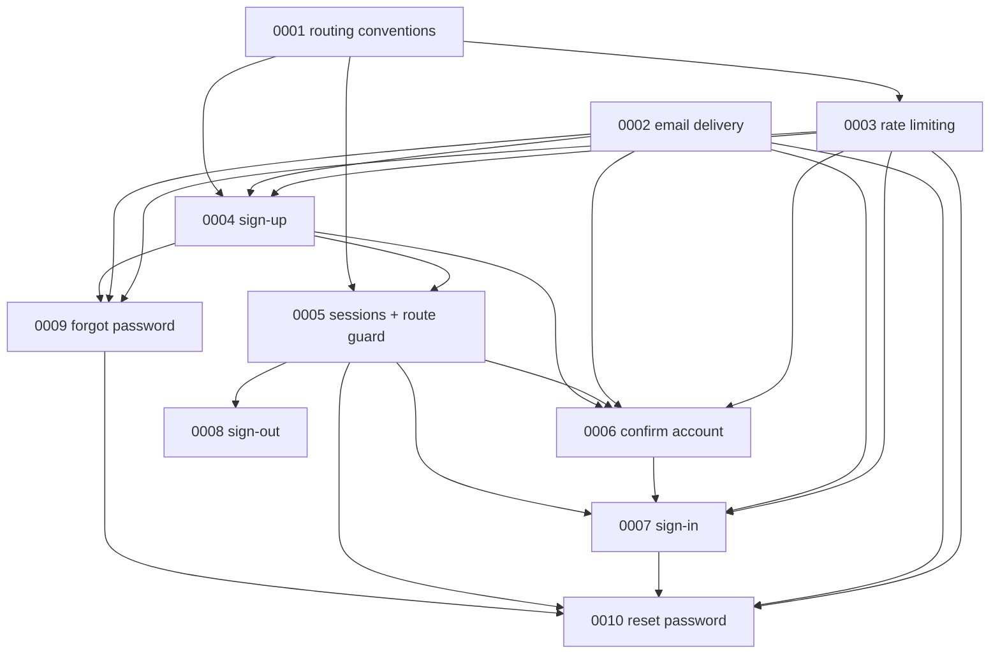

# Breakdown — Autenticação

- **Épico:** auth
- **Data:** 2026-11-09
- **Status:** em implementação (0001 concluída; 0002 a 0010 em rascunho)
- **Prompt original:** "Precisamos implementar o fluxo de autenticação completo": **sign-up** (nome, sobrenome, e-mail, senha e confirmação que devem coincidir; e-mail de confirmação com link e token que confirma a conta, cria a sessão e leva à home), **sign-in** (e-mail + senha, e-mail de nova sessão a cada sessão, ir para a home, "apenas uma sessão seja válida por pessoa… a última sessão é a válida"), **esqueci a senha** (se o e-mail existir, enviar link para a página de reset), **resetar senha** (token, nova senha e confirmação que coincidem, e-mail de sucesso, ir para o sign-in), "todas as páginas de autenticação são públicas, e as demais privadas", `/auth/*` e `/app/*`; "tudo em en-US (adicionar documentação sobre)"; API versionada em `/api/v1/*`, auth em `/api/v1/auth/*`.

## 1. Objetivo

Entregar o ciclo completo de identidade por e-mail e senha: cadastro, confirmação, login com sessão única, recuperação e troca de senha, com rotas públicas (`/auth/*`) e privadas (`/app/*`), API versionada e convenção en-US documentada. Cada spec entrega uma capacidade verificável sozinha e é implementada com `implement-me`, uma por vez.

## 2. Decisões compartilhadas

| Decisão                         | Valor                                                                                                                                                                                                                                       | Origem (usuário / premissa)                       |
| ------------------------------- | ------------------------------------------------------------------------------------------------------------------------------------------------------------------------------------------------------------------------------------------- | ------------------------------------------------- |
| Dono da identidade              | Auth próprio na API (Nest + Postgres), sem Supabase Auth                                                                                                                                                                                    | usuário                                           |
| Transporte da sessão            | Bearer JWT (`sub`, `sid`, `exp`) no header `Authorization`; a API valida o `sid` no banco a cada request                                                                                                                                    | usuário                                           |
| Sessão única                    | Nova sessão (confirmação ou login) revoga a anterior; garantido por índice único parcial no banco                                                                                                                                           | usuário (pedido)                                  |
| E-mail repetido no sign-up      | 409 explícito `EMAIL_ALREADY_REGISTERED`; forgot-password sempre genérico                                                                                                                                                                   | usuário                                           |
| Lacunas incluídas               | Sign-out (0008), reenvio de confirmação (0006), limite de tentativas (0003)                                                                                                                                                                 | usuário                                           |
| Idioma                          | en-US em UI, rotas, endpoints, código, mensagens de erro e e-mails; `.docs/`, specs e ADRs em pt-BR                                                                                                                                         | usuário (leitura do assistente)                   |
| URLs                            | Públicas `/auth/*`, privadas `/app/*`, API `/api/v1/*`                                                                                                                                                                                      | usuário                                           |
| Contratos                       | JSON camelCase; colunas snake_case; erro `{"error":{"code","message","details"}}` com `UPPER_SNAKE_CASE`                                                                                                                                    | premissa                                          |
| Credenciais                     | Senha de 8 a 128 caracteres, sem regras de composição, Argon2id; nome e sobrenome de 1 a 100 caracteres; e-mail com trim e minúsculas, único                                                                                                | premissa                                          |
| Tokens de link                  | Opacos, aleatórios, uso único, só hash SHA-256 no banco; confirmação 24 h, reset 1 h                                                                                                                                                        | premissa                                          |
| Sessão                          | Validade de 7 dias, sem refresh token; token no `localStorage` do SPA (risco de XSS aceito)                                                                                                                                                 | premissa                                          |
| Roteador do SPA                 | TanStack Router (justificativa no ADR do 0001)                                                                                                                                                                                              | usuário (quiz)                                    |
| E-mail                          | `EmailService` abstrai o provedor: **Mailtrap** fora de produção e **Resend** em produção (escolha por `EMAIL_PROVIDER`); provider `capture` nos testes automatizados e E2E; `dispatch` em segundo plano                                    | usuário (Mailtrap e Resend); premissa (`capture`) |
| Rate limit                      | Em memória (instância única), opt-in por rota, políticas nomeadas; valores padrão do 0003 mantidos                                                                                                                                          | premissa (valores: usuário, quiz)                 |
| Acesso a dados                  | `supabase-js` com a service role (só no servidor) + funções SQL chamadas por RPC para o que exige transação; `execute` revogado de `public`/`anon`/`authenticated`. A recomendação do assistente era conexão direta; o usuário escolheu RPC | usuário (quiz)                                    |
| Gate de testes                  | `test:integration` e E2E de auth exigem Docker + Supabase local; testes unitários seguem sem Docker                                                                                                                                         | usuário (quiz)                                    |
| Idioma do `apps/docs`           | en-US (`lang="en-US"`)                                                                                                                                                                                                                      | usuário (quiz)                                    |
| E-mail na confirmação de conta  | Não envia o e-mail de "nova sessão"                                                                                                                                                                                                         | usuário (quiz)                                    |
| Token do reset na URL           | Removido da URL ao carregar a página `/auth/reset-password`                                                                                                                                                                                 | usuário (quiz)                                    |
| Login com conta não confirmada  | Senha correta → 403 `EMAIL_NOT_CONFIRMED` com atalho para reenviar; senha errada → 401 genérico                                                                                                                                             | premissa                                          |
| Forgot com conta não confirmada | Resposta genérica, sem e-mail                                                                                                                                                                                                               | premissa                                          |
| E-mail de nova sessão           | Só no sign-in (não na confirmação), sem IP nem dispositivo                                                                                                                                                                                  | premissa                                          |
| Reset de senha                  | Revoga todas as sessões, envia e-mail de sucesso, não abre sessão                                                                                                                                                                           | premissa                                          |
| Isolamento                      | Por usuário; clube e workspace fora                                                                                                                                                                                                         | premissa                                          |

## 3. Specs (ordem de implementação)

| Ordem | Spec                                                                                    | Capacidade                                                                                                                                       | Depende de                   | Paralelo com | Tamanho | Status    |
| ----- | --------------------------------------------------------------------------------------- | ------------------------------------------------------------------------------------------------------------------------------------------------ | ---------------------------- | ------------ | ------- | --------- |
| 0001  | [`0001-platform-routing-conventions`](../.specs/0001-platform-routing-conventions.md)   | **Habilitadora.** API em `/api/v1`, `GET /api/v1/health`, CORS, envelope de erro, roteador com grupos `/auth` e `/app`, 404, en-US + docs + ADRs | —                            | —            | M       | concluída |
| 0002  | [`0002-auth-email-delivery`](../.specs/0002-auth-email-delivery.md)                     | **Habilitadora.** `EmailService` com Mailtrap (non-prod), Resend (prod) e `capture` (testes), layout base, retry, logs sem PII                   | —                            | —            | P       | rascunho  |
| 0003  | [`0003-auth-rate-limiting`](../.specs/0003-auth-rate-limiting.md)                       | **Habilitadora.** Limite de requisições por rota com políticas de auth                                                                           | 0001                         | —            | P       | rascunho  |
| 0004  | [`0004-auth-sign-up`](../.specs/0004-auth-sign-up.md)                                   | Cadastro, usuário não confirmado, e-mail de confirmação, 409, página `/auth/sign-up`                                                             | 0001, 0002, 0003             | —            | M       | rascunho  |
| 0005  | [`0005-auth-sessions-and-route-guard`](../.specs/0005-auth-sessions-and-route-guard.md) | **Habilitadora com entrega própria.** Sessão única, JWT + `sid`, API fechada por padrão, `/app` privado, home                                    | 0001, 0004                   | —            | M       | rascunho  |
| 0006  | [`0006-auth-confirm-account`](../.specs/0006-auth-confirm-account.md)                   | Confirmar conta pelo link, abrir sessão e ir para `/app`; reenviar confirmação                                                                   | 0002, 0003, 0004, 0005       | —            | M       | rascunho  |
| 0007  | [`0007-auth-sign-in`](../.specs/0007-auth-sign-in.md)                                   | Login, e-mail de nova sessão, sessão única comprovada, página `/auth/sign-in`                                                                    | 0002, 0003, 0005, 0006       | —            | M       | rascunho  |
| 0008  | [`0008-auth-sign-out`](../.specs/0008-auth-sign-out.md)                                 | Encerrar a sessão atual; botão na home                                                                                                           | 0005                         | —            | P       | rascunho  |
| 0009  | [`0009-auth-forgot-password`](../.specs/0009-auth-forgot-password.md)                   | Pedir reset com resposta genérica e link por e-mail; página `/auth/forgot-password`                                                              | 0002, 0003, 0004             | —            | M       | rascunho  |
| 0010  | [`0010-auth-reset-password`](../.specs/0010-auth-reset-password.md)                     | Nova senha com token, revogação de sessões, e-mail de sucesso, ir para o sign-in                                                                 | 0002, 0003, 0005, 0007, 0009 | —            | M       | rascunho  |

**Sobre paralelismo:** pelas dependências, 0001, 0002 (e depois 0003) e, mais adiante, 0008 e 0009 poderiam andar em paralelo. Todas mexem nos mesmos arquivos (`app.module.ts`, módulo `auth`, tabela `auth_tokens`, roteador), então **implemente uma por vez, na ordem acima**.

**Por que as habilitadoras existem:** 0001 serve a todas; 0002 serve a 0004, 0006, 0007, 0009 e 0010; 0003 serve a 0004, 0006, 0007, 0009 e 0010; 0005 serve a 0006, 0007, 0008 e 0010 (e entrega sozinha "rotas privadas" e "sessão única"). Nenhuma cabe dentro da primeira fatia sem estourar o tamanho.

## 4. Dependências

Todas as dependências apontam para número menor (grafo acíclico).

## 5. Rastreabilidade do prompt

| Item do prompt                                                                               | Spec                                                      |
| -------------------------------------------------------------------------------------------- | --------------------------------------------------------- |
| Sign-up: nome, sobrenome, e-mail, senha e confirmação que devem coincidir                    | 0004                                                      |
| E-mail de confirmação de conta com link e token                                              | 0004 (cria e envia), 0002 (envio)                         |
| Clicar no link confirma a conta, cria a sessão e leva à home                                 | 0006 (confirma e abre sessão), 0005 (sessão e home)       |
| Sign-in com e-mail + senha e ida à home                                                      | 0007                                                      |
| E-mail de nova sessão a cada sessão                                                          | 0007                                                      |
| Apenas uma sessão válida por pessoa; a última vale                                           | 0005 (regra e banco), 0007 e 0006 (exercitada nos fluxos) |
| Esqueci a senha: se o e-mail existir, enviar e-mail com link                                 | 0009                                                      |
| Resetar senha: token, nova senha, confirmação que coincide                                   | 0010                                                      |
| E-mail de sucesso e navegação para o sign-in                                                 | 0010                                                      |
| Páginas de auth públicas em `/auth/*`; demais privadas em `/app/*`                           | 0001 (grupos de rota), 0005 (proteção)                    |
| Tudo em en-US e documentar                                                                   | 0001                                                      |
| API versionada: `/api/v1/*`, auth em `/api/v1/auth/*`                                        | 0001 (prefixo), 0004 a 0010 (endpoints)                   |
| Incluídas por escolha do solicitante: sign-out, reenvio de confirmação, limite de tentativas | 0008, 0006, 0003                                          |

## 6. Backlog (candidatas não criadas)

| Candidata                                                               | Por que ficou de fora                                        | Quem decide                    |
| ----------------------------------------------------------------------- | ------------------------------------------------------------ | ------------------------------ |
| MFA e login social                                                      | Não pedido                                                   | Produto                        |
| Troca de senha estando logado; troca de e-mail; exclusão de conta       | Não pedido                                                   | Produto                        |
| Papéis, permissões, clube/workspace                                     | Isolamento decidido por usuário; depende de `BUSINESS.md` §9 | Produto                        |
| Auditoria de acessos; lista de sessões/dispositivos                     | Não pedido; sessão é única                                   | Produto                        |
| Bloqueio de conta após N falhas e captcha                               | O limite por IP + e-mail do 0003 cobre a fase                | Produto                        |
| Aviso "você entrou em outro lugar" para a sessão derrubada              | UX posterior; hoje só volta ao sign-in                       | Produto                        |
| IP/dispositivo no e-mail de nova sessão                                 | Exige coletar IP, o que as regras de log proíbem             | Produto / Segurança            |
| Recuperação por outros canais (SMS, suporte)                            | Não pedido                                                   | Produto                        |
| Histórico de senhas e checagem de senha vazada                          | Não pedido                                                   | Produto / Segurança            |
| Rate limit distribuído (Redis)                                          | API em instância única                                       | Time de engenharia             |
| CSP e hardening contra XSS (token no `localStorage`)                    | Risco aceito; endurecer antes de produção                    | Time de engenharia / Segurança |
| Job de limpeza de tokens e sessões expiradas                            | Crescimento lento, sem impacto agora                         | Time de engenharia             |
| Rotação do segredo JWT                                                  | Fora da fase                                                 | Time de engenharia             |
| Fila/outbox de e-mail; domínio de envio verificado no Resend (SPF/DKIM) | Antes de produção                                            | Time de engenharia / Infra     |

## 7. Perguntas abertas

| Pergunta                                                                                                                            | Impacto | Bloqueante? | Quem decide |
| ----------------------------------------------------------------------------------------------------------------------------------- | ------- | ----------- | ----------- |
| Nenhuma pergunta bloqueante resta. Abertas, todas não bloqueantes (as demais foram resolvidas no quiz de 2026-11-09 e estão em §2): |

| Pergunta                                                                                                                             | Impacto                                                                 | Bloqueante?                    | Quem decide        |
| ------------------------------------------------------------------------------------------------------------------------------------ | ----------------------------------------------------------------------- | ------------------------------ | ------------------ |
| Os testes e o E2E usam o provider `capture` (com rota de apoio a testes só nesse modo) em vez de ler a caixa do Mailtrap. De acordo? | Define como 0004 a 0010 provam o conteúdo dos e-mails sem rede externa. | Não                            | Time de engenharia |
| Mailtrap por SMTP ou por API? Resend por SDK/API ou SMTP?                                                                            | Dependências e variáveis do 0002.                                       | Não (decidir no plano do 0002) | Time de engenharia |
| Quem fornece as credenciais do Mailtrap e do Resend e onde ficam por ambiente?                                                       | Setup de dev e de produção; nunca no repositório.                       | Não                            | Infra              |
| Remetente e domínio de envio em produção (SPF/DKIM no Resend).                                                                       | Entregabilidade; antes de publicar.                                     | Não (antes de produção)        | Produto / Infra    |
| A chamada `supabase-js` + RPC espalha regra transacional em funções SQL. Aceitar o custo de testar cada função em integração?        | Mais testes de integração no 0004, 0005, 0006 e 0010.                   | Não                            | Time de engenharia |

**Resolvidas no quiz (2026-11-09):** acesso a dados = `supabase-js` + RPC; roteador = TanStack Router; gate de testes com Docker aceito; limites do 0003 mantidos; `apps/docs` em en-US; sem e-mail de nova sessão na confirmação; provedores de e-mail = Mailtrap (non-prod) e Resend (prod) atrás do `EmailService`; token removido da URL no reset.

## 8. Handoff

1. `refine-spec <slug>` nas specs em rascunho (sugestão: começar pelo 0002 e pelo 0004, que mudaram com as respostas do quiz).
2. `implement-me 0001-platform-routing-conventions`, depois 0002, 0003, 0004... **uma por vez**, atualizando a coluna **Status** da seção 3 ao concluir.
